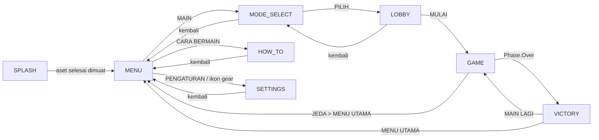

# Peta Aplikasi BACKSTAB!

_Dihasilkan oleh `harness/scripts/appmap_check.py --write` — jangan edit manual._

## Navigasi layar

## Layar

| ID | Composable | Berkas | Referensi | Fungsi |
|---|---|---|---|---|
| SPLASH | `SplashScreen` | `ui/Screens.kt` | `01_splash.png` | Pramuat 120 kartu + ikon, tampilkan logo |
| MENU | `MenuScreen` | `ui/Screens.kt` | `02_main_menu.png` | Menu utama |
| MODE_SELECT | `ModeSelectScreen` | `ui/Screens.kt` | `03_mode_select.png` | Pilih First to Zero / Last Standing |
| LOBBY | `LobbyScreen` | `ui/Screens.kt` | `04_lobby.png` | Jumlah pemain 2-6, ambang eliminasi, daftar pemain |
| GAME | `GameScreen` | `ui/GameScreen.kt` | `05_game_table.png` | Meja permainan 2.5D + semua dialog (warna, target, beri kartu, plus chain, jeda, eliminasi) |
| VICTORY | `VictoryScreen` | `ui/Screens.kt` | `09_victory.png` | Pemenang, peringkat, durasi, chain terpanjang |
| HOW_TO | `HowToScreen` | `ui/Screens.kt` | `11_how_to_play.png` | Cara bermain (2 halaman) |
| SETTINGS | `SettingsScreen` | `ui/Screens.kt` | `12_settings.png` | Suara, musik, getaran, kecepatan animasi |

## Overlay di layar GAME

| ID | Composable | Referensi |
|---|---|---|
| COLOR_PICKER | `ColorDialog` | `06_color_picker.png` |
| TARGET_PICKER | `TargetDialog` | `07_target_picker.png` |
| PLUS_CHAIN | `ChainDialog` | `08_plus_chain.png` |
| ELIMINATED | `EliminatedDialog` | `10_eliminated.png` |
| GIVE_CARD | `GiveDialog` | `-` |
| PAUSE | `PauseDialog` | `-` |

## State machine engine

Sumber: PRD §14.1 → engine/Models.kt Phase

| Phase | Mencakup (PRD §14.1) |
|---|---|
| `Turn` | PlayerTurn + ValidateAction + PlayCard/Combo |
| `Respond` | PenaltyChain + DefenseResponse |
| `Give` | ResolveEffect (HIJACK, pemain memilih kartu yang diberikan) |
| `Call` | ValidateCall (STAB!/BACKSTAB!) |
| `Over` | VictoryCheck |

Urutan resolusi aksi (PRD §15): pilih aksi → validasi legalitas → pindah kartu → efek → update state → cek STAB/BACKSTAB/eliminasi → tentukan pemain berikutnya.

## Invarian

- **deck_total**: 120
- **number_cards**: 80
- **action_cards**: 40
- **starting_hand**: 7
- **elimination_threshold**: 15
- **players**: [2, 6]
- **card_conservation**: hands + draw + discard == 120 (dicek di GameEngine.invariant() setiap aksi)
